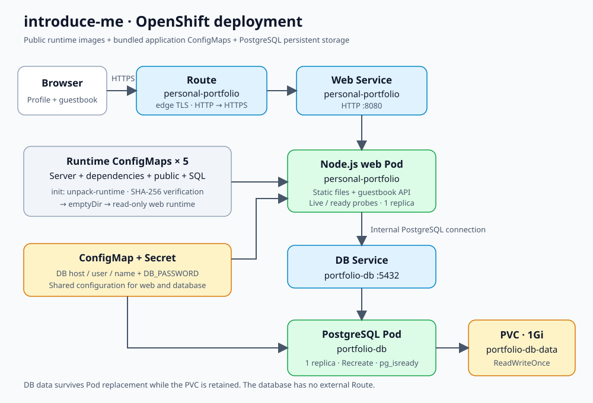

# 202255521 김민욱 — 자기소개 · 방명록

## 1. 컨테이너 소개

이름, 사진, 학교·전공, 관심사, 기술 스택, 프로젝트·논문을 소개하고 방문자가 방명록을 작성하는 웹 서비스입니다. 자기소개 페이지에 서버와 DB를 연결하여 OpenShift의 웹·DB 계층 분리와 데이터 영속성을 확인하려고 이 주제를 선택했습니다.

- Node.js가 자기소개 HTML/CSS/JavaScript와 방명록 API를 함께 제공합니다.
- PostgreSQL에 방명록을 저장하고 최신 글부터 조회합니다. 이름은 1~40자, 내용은 1~1,000자입니다.
- SQL 값 바인딩, 입력 검증, 요청 크기·작성 빈도 제한을 적용하고 사용자 글은 `textContent`로 표시합니다.
- 웹·DB Pod가 교체되어도 PostgreSQL의 PVC를 유지하면 작성한 글이 남습니다.

서비스 소스는 [introduce-me](https://github.com/kmwook03/introduce-me)에서 관리합니다. 이 제출본의 소스 기준은 commit `ee6db88c9eaa8b184ba55e167b550eddaec96dd2`입니다. 해당 commit의 최신 HTML을 반영하도록 실행 번들을 다시 생성했습니다. 번들 SHA-256은 `7c7e8dd55b34f87a4fcb936be2c37bbbdd62e663e718984719740aa2a042c6ce`입니다.

### 제출 파일과 재현 방식

```text
students/202255521/
├── README.md
├── k8s/
│   ├── deployment.yaml          # Node.js 웹·초기화 컨테이너
│   ├── service.yaml             # 웹 Service
│   ├── route.yaml               # 외부 HTTPS 주소
│   ├── configmap.yaml           # 일반 환경설정
│   ├── runtime-configmap.yaml   # 서버·의존성·정적 파일·마이그레이션
│   ├── secret.yaml              # 공개 실습용 DB 비밀번호
│   ├── db-deployment.yaml       # PostgreSQL
│   ├── db-service.yaml          # 내부 DB Service
│   └── pvc.yaml                 # DB 데이터 1Gi
└── images/                      # 아키텍처와 배포 증빙
```

**채점자는 이 폴더의 `k8s/`만으로 배포할 수 있습니다.** 소스 저장소의 공개 여부와 관계없이 GitHub 인증, 소스 clone, npm 설치, 서비스 이미지 빌드가 필요 없습니다. 공개 런타임 이미지와 함께 실행할 코드·의존성이 이미 `runtime-configmap.yaml`에 들어 있습니다. 루트 HTML, 원본 사진, 생성 스크립트도 배포에 필요하지 않습니다.

## 2. 아키텍처



```text
브라우저
  → HTTPS Route personal-portfolio (edge TLS)
    → Service personal-portfolio:8080
      → Node.js 웹 Pod (Deployment personal-portfolio)
        ├─ 자기소개 정적 파일 + 방명록 API
        ├─ ConfigMap + Secret에서 환경설정 읽기
        ├─ init 컨테이너: runtime ConfigMaps → 검증·압축 해제 → emptyDir
        └─ Service portfolio-db:5432
          → PostgreSQL Pod (Deployment portfolio-db, Recreate)
            → PVC portfolio-db-data (1Gi)
```

| Object·설정 | 역할 |
| --- | --- |
| 웹 Deployment | Node.js Pod 1개를 유지하고 리소스·보안·Probe 설정 적용 |
| 초기화 컨테이너 | ConfigMap의 조각을 합쳐 SHA-256 검사 후 실행 파일 복원 |
| 웹 Service | `app=personal-portfolio` Pod의 HTTP 8080 연결 |
| Route | 웹 Service를 HTTPS로 공개하고 HTTP를 HTTPS로 전환 |
| 설정 ConfigMap | 포트, DB 호스트·이름·사용자, 기동 대기 시간, 프록시 설정 |
| 런타임 ConfigMaps 5개 | 번들 서버·의존성, 화면·사진·로고, SQL 마이그레이션 전달 |
| Secret | 웹의 `DB_PASSWORD`와 DB의 `POSTGRESQL_PASSWORD`에 같은 값 전달 |
| DB Deployment | PostgreSQL Pod 1개 유지. Recreate로 DB 교체 시 기존 Pod를 먼저 종료 |
| DB Service | PostgreSQL 5432를 클러스터 내부에 제공. DB용 Route는 없음 |
| PVC | PostgreSQL 데이터 디렉터리 `/var/lib/pgsql/data` 보존 |
| emptyDir | 복원한 웹 실행 파일 저장. DB 데이터는 저장하지 않음 |
| Probe | 시작·프로세스 생존·요청 처리 준비 상태를 각각 검사 |

웹 liveness는 `/health/live`, readiness는 `/health/ready`를 사용합니다. DB 장애 중 웹 프로세스는 살아 있어도 readiness가 실패하므로 Route에서 해당 Pod로 트래픽이 전달되지 않을 수 있습니다. DB Probe는 `pg_isready`를 사용합니다.

번들은 일반 `oc apply`의 annotation 크기 제한을 고려해 128KiB 이하의 조각 5개로 나눴습니다. 의존성은 미리 번들에 포함되어 Pod 기동 시 외부 다운로드를 하지 않습니다. YAML은 namespace·고정 UID·Route host·status 등 클러스터 자동 생성 필드를 지정하지 않습니다.

## 3. 사용 이미지

| 대상 | 이미지·포트·선택 이유 |
| --- | --- |
| 웹·초기화 | `docker.io/library/node:24.22.1-bookworm-slim` — HTTP 8080, Node.js 서버 실행과 번들 복원 |
| DB | `quay.io/sclorg/postgresql-16-c9s` — PostgreSQL 5432, OpenShift 임의 UID를 지원하는 DB 이미지 |

YAML에는 재현성을 위해 다음 digest를 고정했습니다.

```text
node:24.22.1-bookworm-slim
sha256:55fb5f5a527ea2c5c4a95f963e48ef90aa38c7b346054fdc8ee9957a2b55d205

postgresql-16-c9s
sha256:66566a27e08ec28d739c5fc54dcd47a4f0b505682d469589e9d493ae0b7bc9ab
```

웹·초기화 컨테이너의 CPU 요청/제한은 50m/250m, 메모리는 64Mi/192Mi입니다. DB는 CPU 100m/500m, 메모리 128Mi/512Mi입니다. 비루트 실행, 권한 상승 금지, capability 제거를 적용합니다. 웹 루트 파일시스템은 읽기 전용입니다.

## 4. 배포 방법

### 새 프로젝트에서 배포·채점

OpenShift 콘솔의 **Copy login command**로 로그인하고 본인 프로젝트를 선택한 뒤 실행합니다. 기본 StorageClass 또는 PVC를 할당할 스토리지가 필요합니다.

```bash
cd students/202255521
oc whoami
oc project
oc apply -f k8s/
oc rollout status deployment/portfolio-db --timeout=240s
oc rollout status deployment/personal-portfolio --timeout=240s
oc get pods,svc,route,pvc
```

`secret.yaml`도 적용되므로 별도의 Secret 생성 명령이 필요 없습니다. 비밀번호는 **이 과제만을 위한 공개 실습용 값**입니다. 실제 서비스 비밀번호나 GitHub·OpenShift 토큰과 재사용하지 않습니다. Secret은 비밀값 자체를 암호화하는 기능이 아닙니다.

출력되는 HTTPS 주소로 브라우저에서 접속합니다.

```bash
oc get route personal-portfolio \
  -o jsonpath='{"https://"}{.spec.host}{"\n"}'
```

Pod 2개가 각각 `Running`, `READY 1/1`이고 PVC가 `Bound`여야 합니다. 화면에서 자기소개·사진·로고가 보이고 방명록 작성 후 새로고침해도 글이 조회되어야 합니다.

```bash
# ROUTE_HOST를 위 명령에서 얻은 호스트명으로 바꿉니다.
curl -I https://ROUTE_HOST
curl https://ROUTE_HOST/health/ready
curl https://ROUTE_HOST/api/guestbook
```

정상 상태는 HTTP 200입니다. 방명록 목록은 `items`, `nextCursor`가 있는 JSON으로 반환됩니다.

### 기존 introduce-me 배포를 같은 프로젝트에서 갱신

기존 서비스와 웹·DB·PVC·Route 이름을 유지했습니다. 기존 DB 비밀번호가 제출본과 다를 수 있으므로 **현재 방명록을 유지하며 전환할 때는 `secret.yaml`을 제외하고 적용**합니다. 아래 절차는 `portfolio-db-auth` Secret과 기존 DB가 이미 있는 환경에서만 사용합니다.

```bash
oc get secret portfolio-db-auth
for manifest in k8s/*.yaml; do
  if [ "$manifest" != "k8s/secret.yaml" ]; then
    oc apply -f "$manifest"
  fi
done
oc rollout status deployment/portfolio-db --timeout=240s
oc rollout status deployment/personal-portfolio --timeout=240s
```

이후 같은 프로젝트에서 갱신할 때도 기존 비밀번호를 유지하려면 이 절차를 사용합니다. 새 프로젝트에서 채점할 때는 앞의 `oc apply -f k8s/`를 사용합니다. 설정·Secret을 의도적으로 바꾼 경우 웹 Deployment를 재시작하고, DB 비밀번호 변경은 DB 내부 계정과도 일치시켜야 합니다.

### 코드 변경 반영

프로필·화면·서버 변경은 서비스 소스 저장소에서 수행합니다. 그 저장소에서 `npm ci`, `npm run deploy:generate`, `npm run deploy:check`를 실행한 뒤 `deploy/k8s/`의 파일을 이 제출본에 전달합니다. `web-deployment.yaml`은 `deployment.yaml`, `web-service.yaml`은 `service.yaml`에 대응합니다. 큰 런타임 ConfigMap을 직접 편집하지 않습니다.

### 영속성 및 재현성 확인

방명록에 식별 가능한 글을 작성한 후 각각 재시작하고 글이 남는지 확인합니다.

```bash
oc rollout restart deployment/personal-portfolio
oc rollout status deployment/personal-portfolio --timeout=240s
oc rollout restart deployment/portfolio-db
oc rollout status deployment/portfolio-db --timeout=240s
oc rollout status deployment/personal-portfolio --timeout=240s
```

과제의 전체 삭제·재생성 검증은 캡처·필요한 백업을 확보한 후 별도로 수행합니다. **다음 명령은 PVC도 삭제하므로 기존 방명록 글이 사라질 수 있습니다.**

```bash
oc delete -f k8s/ --wait=true
oc apply -f k8s/
oc rollout status deployment/portfolio-db --timeout=240s
oc rollout status deployment/personal-portfolio --timeout=240s
```

새 방명록에 글 작성·조회, Route 접속, PVC 상태를 다시 확인합니다. Pod 재시작 시 데이터 보존과 PVC 삭제 후 새 배포는 다른 검사입니다.

## 5. 배포 결과

**사용자가 introduce-me의 Route 접속 성공을 확인했습니다.** 이 제출용 YAML을 적용한 결과와 실제 URL·캡처는 아래 표 및 `images/`에 추가해야 합니다. 로컬 검사나 아키텍처 이미지를 실제 OpenShift 배포 증빙으로 대신하지 않습니다.

| 확인 항목 | 기록 |
| --- | --- |
| introduce-me Route 접속 | 사용자 확인: 성공 |
| 실제 Route URL·배포 일시 | 실제 값 기록 필요 |
| 이 제출본 적용 후 웹·DB READY / PVC Bound | 확인 및 캡처 필요 |
| 방명록 작성·조회 | 실제 결과 기록 필요 |
| 웹·DB 재시작 후 글 보존 | 실제 결과 기록 필요 |
| PVC 포함 전체 삭제 후 YAML만으로 재배포 | 실제 결과 기록 필요 |

제출본의 로컬 검증 결과는 다음과 같습니다. 검증 환경에 `oc`가 없어 이 결과를 실제 OpenShift 배포 성공으로 간주하지 않습니다.

| 로컬 검사 | 결과 |
| --- | --- |
| YAML 파싱·13개 Object 참조·보안·리소스·Probe·문서 링크 | 통과 |
| 최신 소스에서 번들 재생성·최신 상태 검사·배포 번들 테스트 | 통과 |
| 일반 apply 크기 제한·5개 조각의 checksum | 통과 |
| 제출 YAML의 초기화 명령으로 독립 런타임 복원 | 통과. 소스·node_modules 없이 실행 |
| 임시 PostgreSQL 자동 마이그레이션·방명록 작성·조회 | 통과 |
| 웹 재시작 후 글 보존·DB 장애 시 ready 503/live 200·DB 복구 | 통과 |

학번 폴더에서 다음 출력과 캡처를 저장합니다. 토큰·Secret 내용은 캡처하지 않습니다.

```bash
oc get all > images/oc-get-all.txt
oc get pvc > images/oc-get-pvc.txt
oc get route personal-portfolio \
  -o jsonpath='{"https://"}{.spec.host}{"\n"}' > images/route-url.txt
```

- `images/topology.png`: Topology 또는 웹·DB 리소스 정상 상태 화면
- `images/browser.png`: 실제 HTTPS Route의 자기소개와 방명록 화면
- `images/persistence.png`: 재시작 후 작성한 글이 남아 있는 화면

캡처를 저장한 후 README에 `` 등의 형식으로 삽입합니다. 기존 `images/MinWook.jpg`는 프로필 원본 자료이며 배포 성공 캡처가 아닙니다.

## 6. 어려웠던 점과 해결 과정

- 이전 구성은 Nginx 정적 페이지여서 방명록 API와 DB가 없었습니다. Node.js 웹·PostgreSQL Deployment와 PVC를 구성해 서버에서 글을 저장하도록 바꿨습니다.
- 서비스 소스 저장소는 `secret.yaml`을 Git에서 제외해 새 환경에서 DB 인증 Secret이 누락될 수 있었습니다. 제출본에는 실제 비밀번호와 구분한 공개 실습용 Secret을 포함해 `oc apply -f k8s/`만으로 생성되게 했습니다.
- ConfigMap 하나에 실행 번들을 넣으면 일반 apply의 annotation 크기 제한을 넘을 수 있습니다. 실행 번들을 작은 ConfigMap 5개로 나누고 초기화 컨테이너에서 checksum 검사 후 복원합니다.
- private 저장소 접근을 채점자에게 요구하지 않도록 소스·의존성·정적 파일·마이그레이션을 제출 YAML에 포함했습니다.
- `TRUST_PROXY=false`이므로 라우터를 통해 들어오는 방문자가 분당 5회 작성 한도를 공유할 수 있습니다. 연속 테스트에서 429가 나오면 잠시 기다립니다. 방문자별 제한은 실제 router CIDR를 확인한 뒤 설정해야 합니다.

추가 장애는 `oc get events --sort-by=.metadata.creationTimestamp`, `oc describe pod <이름>`, `oc logs deployment/personal-portfolio -c web`, `oc logs deployment/portfolio-db`로 확인합니다.

## 7. AI·참고자료 활용 내역

- OpenAI Codex: 기존 화면 이관, 방명록 서버·DB·배포 파일 개발 지원, 과제 조건 확인, 제출용 YAML·문서·구성도 정리 및 로컬 검증에 활용했습니다. 실제 Route 접속 성공은 사용자가 확인했으며 제출본 클러스터 검증·캡처는 별도로 기록합니다.
- [서비스 소스와 개발 문서](https://github.com/kmwook03/introduce-me): 서버·화면·배포 산출물 관리.
- [OpenShift CLI 문서](https://docs.redhat.com/en/documentation/openshift_container_platform/4.20/html/cli_tools/openshift-cli-oc): 로그인·배포·조회 명령.
- [OpenShift Route 문서](https://docs.redhat.com/en/documentation/openshift_container_platform/4.20/html/ingress_and_load_balancing/routes): Service 외부 공개와 edge TLS.
- [SCLorg PostgreSQL 이미지 문서](https://github.com/sclorg/postgresql-container/blob/master/16/root/usr/share/container-scripts/postgresql/README.md): DB 환경변수와 데이터 경로.
- [Kubernetes ConfigMap](https://kubernetes.io/docs/concepts/configuration/configmap/), [Secret](https://kubernetes.io/docs/concepts/configuration/secret/), [영속 볼륨](https://kubernetes.io/docs/concepts/storage/persistent-volumes/): 설정·인증·DB 데이터 보존.
