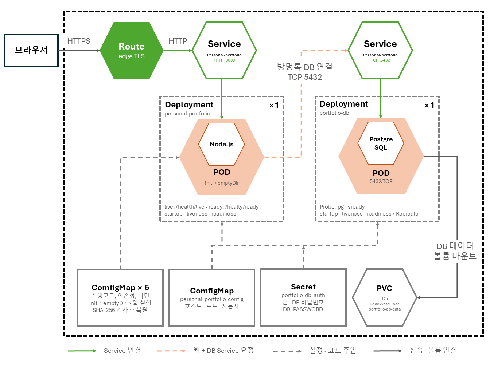
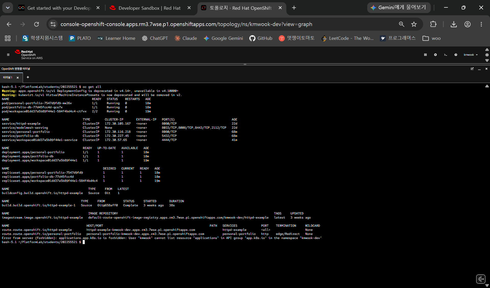
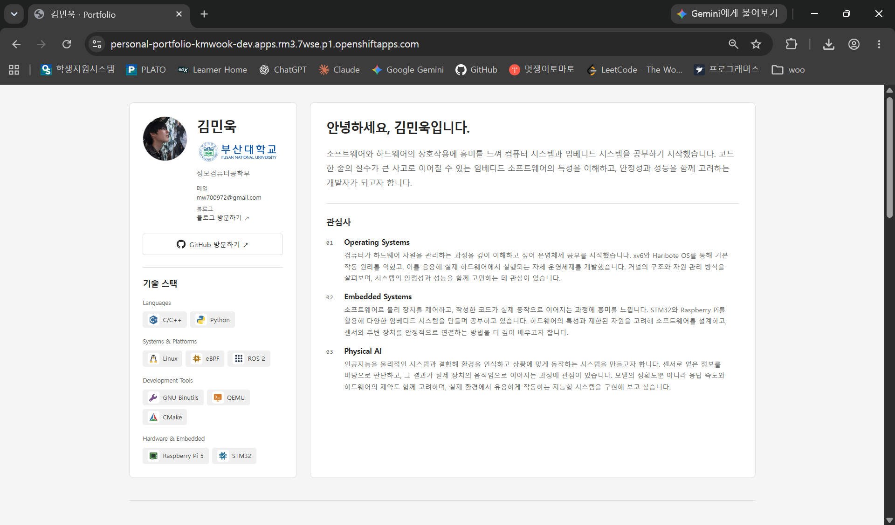
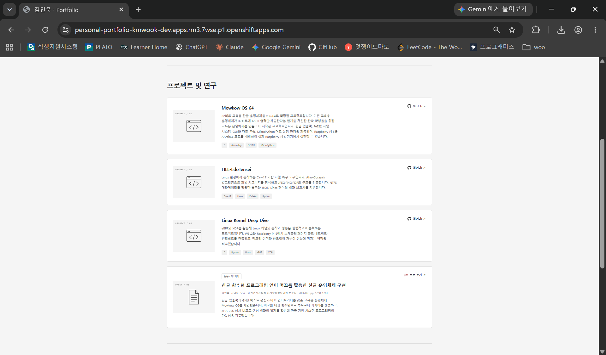
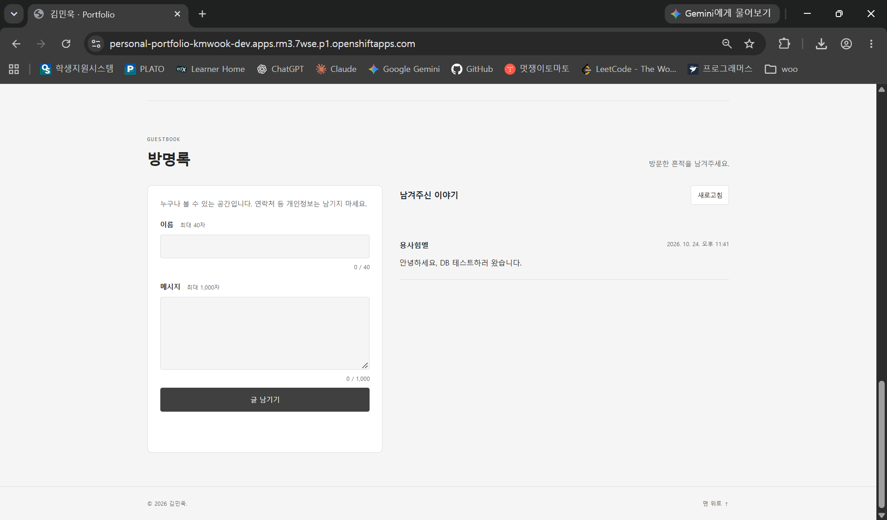

# 202255521 김민욱: 김민욱 포트폴리오

## 1. 컨테이너 소개

제가 진행한 프로젝트와 논문을 소개하는 `김민욱 포트폴리오` 웹 페이지입니다. 제 프로필과 프로젝트 내역을  살펴볼 수 있고, github 링크 또는 논문 링크를 클릭해 리포지토리로 이동할 수 있습니다. 포트폴리오를 조회한 후 한마디 거들고 싶다면 방명록을 남길 수 있습니다. 평소에도 포트폴리오 페이지를 하나 만들고싶다고 생각했어서 자기소개 웹페이지 주제를 선택했습니다.

Node.js가 자기소개 HTML/CSS/JavaScript와 방명록 API를 함께 제공하고, PostgreSQL에 방명록을 저장합니다. 저장된 글은 가장 최근에 써진 글 부터 조회할 수 있으며, 이름은 최대 40자, 내용은 최대 1,000자로 작성할 수 있습니다. SQL 값 바인딩, 입력 검증, 요청 크기, 작성 빈도 제한을 적용하고 사용자 글은 `textContent`로 표시합니다. 웹, DB Pod가 교체되어도 PostgreSQL의 PVC를 유지하면 작성한 글이 남도록 하였습니다.

### 제출 파일

```text
students/202255521/
├── README.md
├── k8s/
│   ├── deployment.yaml          # Node.js 웹, 초기화 컨테이너
│   ├── service.yaml             # 웹 Service
│   ├── route.yaml               # 외부 HTTPS 주소
│   ├── configmap.yaml           # 일반 환경설정
│   ├── runtime-configmap.yaml   # 서버, 의존성, 정적 파일, 마이그레이션
│   ├── secret.yaml              # 공개 실습용 DB 비밀번호
│   ├── db-deployment.yaml       # PostgreSQL
│   ├── db-service.yaml          # 내부 DB Service
│   └── pvc.yaml                 # DB 데이터 1Gi
└── images/                      # 아키텍처와 배포 증빙
```

## 2. 아키텍처



| Object | 역할 |
| --- | --- |
| 웹 Deployment | Node.js Pod 1개를 유지하고 리소스, 보안, Probe 설정 적용 |
| 초기화 컨테이너 | ConfigMap의 조각을 합쳐 SHA-256 검사 후 실행 파일 복원 |
| 웹 Service | `app=personal-portfolio` Pod의 HTTP 8080 연결 |
| Route | 웹 Service를 HTTPS로 공개하고 HTTP를 HTTPS로 전환 |
| 설정 ConfigMap | 포트, DB 호스트, 이름, 사용자, 기동 대기 시간, 프록시 설정 |
| 런타임 ConfigMaps 5개 | 번들 서버, 의존성, 화면, 사진, 로고, SQL 마이그레이션 전달 |
| Secret | 웹의 `DB_PASSWORD`와 DB의 `POSTGRESQL_PASSWORD`에 같은 값 전달 |
| DB Deployment | PostgreSQL Pod 1개 유지, Recreate로 DB 교체 시 기존 Pod를 먼저 종료 |
| DB Service | PostgreSQL 5432를 클러스터 내부에 제공, DB용 Route는 없음 |
| PVC | PostgreSQL 데이터 디렉터리 `/var/lib/pgsql/data` 보존 |
| emptyDir | 복원한 웹 실행 파일 저장. DB 데이터는 저장하지 않음 |
| Probe | 시작·프로세스 생존·요청 처리 준비 상태를 각각 검사 |

웹 liveness는 `/health/live`, readiness는 `/health/ready`를 사용합니다. DB 장애 중 웹 프로세스는 살아 있어도 readiness가 실패하므로 Route에서 해당 Pod로 트래픽이 전달되지 않을 수 있습니다. DB Probe는 `pg_isready`를 사용합니다.

번들은 일반 `oc apply`의 annotation 크기 제한을 고려해 128KiB 이하의 조각 5개로 나누었고, 의존성을 미리 번들에 포함시켜 Pod 기동 시 외부 다운로드를 하지 않도록 설계했습니다. 

## 3. 사용 이미지

### 이미지 주소

* 웹 및 초기화 컨테이너: `docker.io/library/node:24.22.1-bookworm-slim`
* DB 컨테이너: `quay.io/sclorg/postgresql-16-c9s`

Node.js는 자기소개 정적 파일과 방명록 API를 하나의 웹 서버에서 제공하기 위해 선택했습니다. 초기화 컨테이너에서도 같은 이미지를 사용해 실행 번들을 검증하고 복원합니다.

PostgreSQL은 방명록 데이터를 저장하고 웹 서버와 DB를 분리하기 위해 선택했습니다. SCLorg 이미지는 OpenShift의 임의 비루트 UID 실행을 지원하며, 데이터 디렉터리를 PVC에 연결할 수 있습니다.

| 대상 | 포트 | 용도 |
| --- | --- | --- |
| 웹 컨테이너 | HTTP `8080` | 자기소개 화면과 방명록 API 제공 |
| 초기화 컨테이너 | 없음 | 번들 복원 후 종료 |
| DB 컨테이너 | TCP `5432` | 클러스터 내부의 PostgreSQL 연결 |

YAML에는 재현성을 위해 다음 digest를 고정했습니다.

```text
node:24.22.1-bookworm-slim
sha256:55fb5f5a527ea2c5c4a95f963e48ef90aa38c7b346054fdc8ee9957a2b55d205

postgresql-16-c9s
sha256:66566a27e08ec28d739c5fc54dcd47a4f0b505682d469589e9d493ae0b7bc9ab
```

### 리소스 및 보안 설정

| 대상 | CPU 요청 | CPU 제한 | 메모리 요청 | 메모리 제한 |
| --- | --- | --- | --- | --- |
| 웹·초기화 컨테이너 각각 | 50m | 250m | 64Mi | 192Mi |
| DB 컨테이너 | 100m | 500m | 128Mi | 512Mi |

비루트 실행, 권한 상승 금지, capability 제거를 적용하였고 웹 루트 파일시스템은 읽기 전용입니다.

## 4. 배포 방법

### 새 프로젝트에서 배포

OpenShift 콘솔의 `Copy login command`로 로그인하고 본인 프로젝트를 선택한 뒤 실행합니다. 기본 StorageClass 또는 PVC를 할당할 스토리지가 필요합니다.

배포 절차(`~/PlatformLab/students/202255521` 위치에서 진행합니다.)
```bash
oc apply -f k8s/
oc rollout status deployment/portfolio-db --timeout=240s
oc rollout status deployment/personal-portfolio --timeout=240s
oc get pods,svc,route,pvc
```

예상 출력
```bash
bash-5.1 ~/PlatformLab/students/202255521 $ oc apply -f k8s/
configmap/personal-portfolio-config unchanged
deployment.apps/portfolio-db created
service/portfolio-db unchanged
deployment.apps/personal-portfolio created
persistentvolumeclaim/portfolio-db-data unchanged
route.route.openshift.io/personal-portfolio unchanged
configmap/personal-portfolio-runtime-00 unchanged
configmap/personal-portfolio-runtime-01 unchanged
configmap/personal-portfolio-runtime-02 unchanged
configmap/personal-portfolio-runtime-03 unchanged
configmap/personal-portfolio-runtime-04 unchanged
secret/portfolio-db-auth configured
service/personal-portfolio unchanged
bash-5.1 ~/PlatformLab/students/202255521 $ oc rollout status deployment/portfolio-db --timeout=240s
deployment "portfolio-db" successfully rolled out
bash-5.1 ~/PlatformLab/students/202255521 $ oc rollout status deployment/personal-portfolio --timeout=240s
deployment "personal-portfolio" successfully rolled out
bash-5.1 ~/PlatformLab/students/202255521 $ oc get pods,svc,route,pvc
NAME                                             READY   STATUS    RESTARTS   AGE
pod/personal-portfolio-7547d9fd9-mw26v           1/1     Running   0          2m2s
pod/portfolio-db-77d45fcc4d-qcs7x                1/1     Running   0          2m2s
pod/workspace01dd37a5b89f44e1-584f4bd4c4-ctfvx   2/2     Running   0          3m14s

NAME                                        TYPE        CLUSTER-IP       EXTERNAL-IP   PORT(S)                               AGE
service/httpd-example                       ClusterIP   172.30.105.167   <none>        8080/TCP                              22d
service/modelmesh-serving                   ClusterIP   None             <none>        8033/TCP,8008/TCP,8443/TCP,2112/TCP   22d
service/personal-portfolio                  ClusterIP   172.30.116.218   <none>        8080/TCP                              51m
service/portfolio-db                        ClusterIP   172.30.227.45    <none>        5432/TCP                              51m
service/workspace01dd37a5b89f44e1-service   ClusterIP   172.30.57.65     <none>        4444/TCP                              25m

NAME                                          HOST/PORT                                                          PATH   SERVICES             PORT    TERMINATION     WILDCARD
route.route.openshift.io/httpd-example        httpd-example-kmwook-dev.apps.rm3.7wse.p1.openshiftapps.com               httpd-example        <all>                   None
route.route.openshift.io/personal-portfolio   personal-portfolio-kmwook-dev.apps.rm3.7wse.p1.openshiftapps.com          personal-portfolio   http    edge/Redirect   None

NAME                                      STATUS    VOLUME                                     CAPACITY   ACCESS MODES   STORAGECLASS   VOLUMEATTRIBUTESCLASS   AGE
persistentvolumeclaim/mongodb-data        Bound     pvc-68c8e0c2-7766-4a2a-8db0-38b02b966893   1Gi        RWO            gp3            <unset>                 22d
persistentvolumeclaim/my-storage-claim    Pending                                                                        gp3            <unset>                 22d
persistentvolumeclaim/portfolio-db-data   Bound     pvc-8ebd6ed8-c99c-4ed2-8b6d-faca00adbc04   1Gi        RWO            gp3            <unset>                 51m
```

이후 아래 명령어로 출력되는 HTTPS 주소로 브라우저에서 접속합니다.

```bash
oc get route personal-portfolio \
  -o jsonpath='{"https://"}{.spec.host}{"\n"}'
```

Pod 2개가 각각 `Running`, `READY 1/1`이고 PVC가 `Bound`여야 합니다. 화면에서 자기소개·사진·로고가 보이고 방명록 작성 후 새로고침해도 글이 조회되어야 합니다.

```bash
# ROUTE_HOST를 위 명령에서 얻은 호스트명으로 바꿉니다.
curl -I https://ROUTE_HOST
curl https://ROUTE_HOST/health/ready
curl https://ROUTE_HOST/api/guestbook
```

정상 상태는 HTTP 200입니다. 방명록 목록은 `items`, `nextCursor`가 있는 JSON으로 반환됩니다.

## 5. 배포 결과

| 확인 항목 | 기록 |
| --- | --- |
| introduce-me Route 접속 | 성공. 자기소개·프로젝트·방명록 화면 캡처 첨부 |
| 실제 Route URL | [자기소개 · 방명록 접속](https://personal-portfolio-kmwook-dev.apps.rm3.7wse.p1.openshiftapps.com) |
| 배포 일시 | 별도 기록 필요 |
| 웹·DB READY | `oc get all` 캡처에서 두 Pod가 `Running`, `READY 1/1`이고 두 Deployment가 `AVAILABLE 1`임을 확인 |
| PVC Bound | 별도 확인·캡처 필요 |
| 방명록 글 조회 | 저장된 글이 화면에 표시되는 것을 확인 |
| 웹·DB 재시작 후 글 보존 | 실제 결과 기록 필요 |
| PVC 포함 전체 삭제 후 YAML만으로 재배포 | 실제 결과 기록 필요 |

### OpenShift 리소스 배포 상태

`oc get all` 출력에서 웹·DB Pod와 Deployment의 정상 상태, 웹·DB Service, 외부 접속용 Route를 확인했습니다.



### 자기소개·기술 스택 화면

실제 Route로 접속한 화면입니다. 프로필 사진, 학교·전공, 자기소개, 관심사와 기술 스택이 표시됩니다.



### 프로젝트 및 연구 화면

프로젝트 소개와 GitHub 링크, 논문 정보와 논문 링크를 확인할 수 있습니다.



### 방명록 화면

이름·메시지 입력 폼과 저장된 방명록 글이 표시됩니다.



## 6. 어려웠던 점과 해결 과정

- ConfigMap 하나에 실행 번들을 넣어서 일반 apply의 annotation 크기 제한을 넘어 오류가 발생했었습니다. 실행 번들을 작은 ConfigMap 5개로 나누는 방식으로 해결했습니다.
- 컨테이너 내부에만 데이터를 저장했더니 Pod가 교체될 때 기존에 작성된 방명록이 사라지는 문제가 있었습니다. PostgreSQL 데이터 디렉터리를 1Gi PVC에 연결해 같은 PVC를 유지하여 데이터를 재사용하도록 해결했습니다. DB 배포에는 Recreate 전략을 적용해 교체 과정에서 기존 DB Pod 먼저 종료하도록 했습니다.
- 웹과 DB를 함께 배포할 때 PostgreSQL 초기화가 끝나는 시점이 달라 연결 준비 상태를 고려해야 했습니다. 일시적인 DB 오류는 최대 90초 동안 재시도하도록 구현하고 DB 초기화가 완료된 뒤 readiness 검사를 통과하도록 구성했습니다.

## 7. AI·참고자료 활용 내역

- OpenAI Codex(ChatGPT 6.1 sol): 방명록 서버, DB, 배포 파일 개발에 사용했습니다.
- [OpenShift CLI 문서](https://docs.redhat.com/en/documentation/openshift_container_platform/4.20/html/cli_tools/openshift-cli-oc): 로그인, 배포, 조회에 사용되는 명령어를 참고했습니다.
- [OpenShift Route 문서](https://docs.redhat.com/en/documentation/openshift_container_platform/4.20/html/ingress_and_load_balancing/routes): Service 외부 공개와 edge TLS.
- [SCLorg PostgreSQL 이미지 문서](https://github.com/sclorg/postgresql-container/blob/master/16/root/usr/share/container-scripts/postgresql/README.md): 홈페이지 개발 중 DB 환경변수와 데이터 경로를 참고했습니다.
- [Kubernetes ConfigMap](https://kubernetes.io/docs/concepts/configuration/configmap/), [Secret](https://kubernetes.io/docs/concepts/configuration/secret/), [영속 볼륨](https://kubernetes.io/docs/concepts/storage/persistent-volumes/): 설정, 인증, DB 데이터 보존 방식을 참고했습니다.
